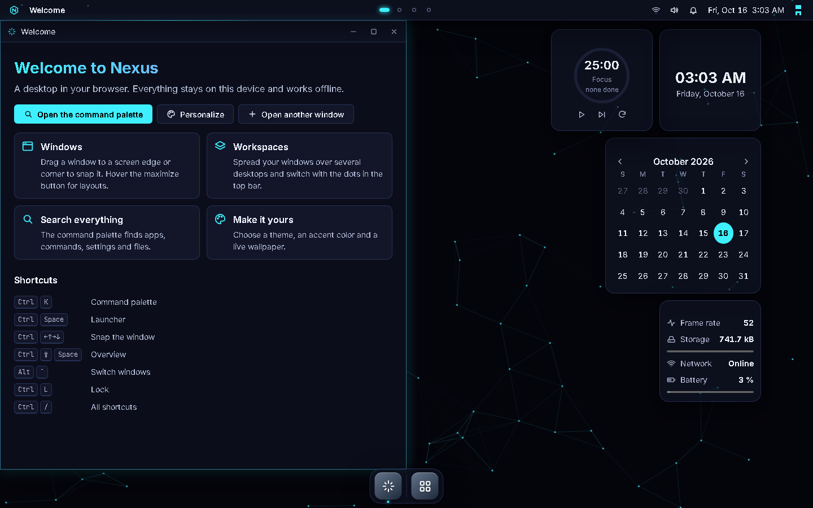

# ⚡ Nexus Arcade OS

[](https://github.com/m1m1kyu1453/nexus-arcade-os/actions/workflows/ci.yml)

A futuristic desktop operating system that runs in your browser: windows, a dock, a file system,
a terminal, and dozens of apps and games that share data with each other. It is an installable
Progressive Web App and works **offline** after the first visit. There are no accounts and no
backend: your data stays in your browser.

> **Status: phase 2 (shell).** The desktop works: windows with snapping and workspaces, dock,
> launcher, command palette, notification center, widgets, live wallpapers, lock screen, and a
> phone layout. Apps arrive from phase 3 on. See [PROGRESS.md](PROGRESS.md) for the full roadmap.



**Live site:** https://nexus-arcade-os.onrender.com · **Nexus Lite:** [download `nexus-lite.html`](https://nexus-arcade-os.onrender.com/nexus-lite.html)

## Two editions

- **Website:** installable PWA with offline support and automatic update notices.
- **Nexus Lite:** the same OS as a single `nexus-lite.html` file. Download it, double-click it,
  done. No server, no install. (No offline installer or update notices, since it _is_ the file.)
  Data in Lite is separate from the website; use backup/restore to move it.

## Privacy

No analytics, no tracking, no external requests. The only network requests Nexus will ever make
are ones you configure yourself (an AI server, the HTTP client app).

## Run it locally

Requires Node 24 (`.nvmrc`).

```sh
npm install
npm run dev          # development server
npm run build        # dist/ (website) + dist/nexus-lite.html
npm run preview      # serve the production build
npm test             # unit tests
npx playwright install chromium   # once
npm run test:e2e     # end-to-end tests against the build (run `npm run build` first)
```

## Architecture

Vanilla JavaScript (ES2022 modules, Web Components), no UI framework. Vite for bundling, Vitest and
Playwright for tests, JSDoc types checked with `tsc`. Every app is its own lazily loaded chunk and
talks to the OS only through a `ctx` object. Details: [docs/architecture.md](docs/architecture.md).

## Writing an app

Every app is a folder in `src/apps/<name>/` with a data-only `manifest.js` and a lazily loaded
`index.js` that exports `mount(container, ctx, args)` and returns `{ unmount, onSuspend, onResume }`.
Apps reach the OS only through `ctx`: storage collections declared in the manifest, the file
system, settings, notifications, commands, shortcuts, intents, i18n, theme, scheduler and more.

Types: [`src/kernel/types.d.ts`](src/kernel/types.d.ts) · Events: [docs/events.md](docs/events.md) ·
A complete example: [`src/dev/test-app`](src/dev/test-app).

## License

[MIT](LICENSE). Bundled fonts: Inter and JetBrains Mono, both under the SIL Open Font License
(texts in `src/styles/fonts/`).
